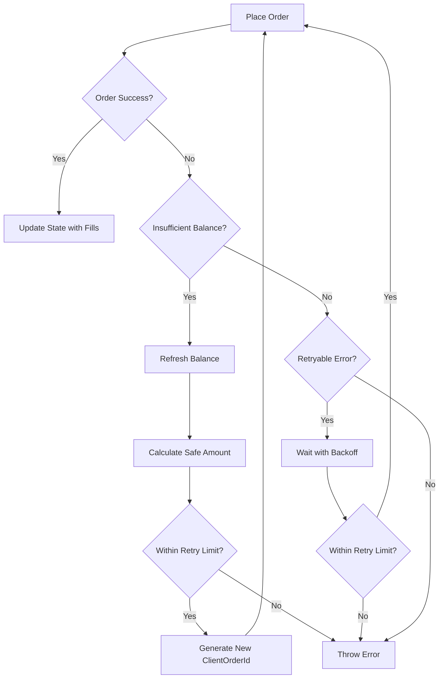

# Retry-on-Insufficient-Balance Strategy Architecture

## Overview

This document describes the architectural design of the retry-on-insufficient-balance strategy implemented in the BTC Trading Bot. This strategy replaces the previous drift detection blocking mechanism with a more resilient approach that automatically recovers from temporary balance mismatches.

## Problem Statement

Previously, the bot would halt trading when detecting balance drift (≥0.5% mismatch between expected and actual balances). This approach had several drawbacks:

1. **Trading interruption** - Legitimate trades were blocked during transient mismatches
2. **Manual intervention required** - Operators had to manually resolve drift issues
3. **Lost opportunities** - Market opportunities were missed during drift pauses
4. **False positives** - Network delays or timing issues could trigger unnecessary halts

## Solution Architecture

### Core Concept

Instead of blocking on balance mismatches, the bot now:

1. **Detects** insufficient balance errors during order placement
2. **Refreshes** balance directly from the exchange
3. **Recalculates** safe order quantities based on actual available balance
4. **Retries** with adjusted parameters
5. **Reconciles** using fills data for precise state tracking

### Key Components

#### 1. Error Detection Layer

```typescript
interface BalanceErrorDetector {
  isInsufficientBalanceError(error: Error): boolean;
}
```

Recognizes balance errors through:

- Error message patterns ("insufficient balance", "account has insufficient")
- Binance error codes (e.g., "-2010")

#### 2. Balance Refresh Service

```typescript
interface BalanceRefreshService {
  refreshBalance(asset: string): Promise<Balance>;
}
```

- Queries Binance API for current available balance
- Returns both free and locked amounts
- Cached for performance with TTL

#### 3. Safe Quantity Calculator

```typescript
interface SafeQuantityCalculator {
  calculateSafeAmount(
    availableBalance: Decimal,
    intendedAmount: Decimal,
    safetyFactor: number,
  ): Decimal;
}
```

Applies multi-layer safety:

- Takes minimum of available balance and intended amount
- Applies safety factor (99.5%) for fees and rounding
- Quantizes to exchange step size
- Validates against minimum constraints

#### 4. Retry Orchestrator

```typescript
interface RetryOrchestrator {
  executeWithRetry<T>(
    operation: () => Promise<T>,
    config: RetryConfig,
  ): Promise<T>;
}
```

Manages retry logic:

- Separate retry counters for balance vs. other errors
- Immediate retry for balance errors (no delay)
- Exponential backoff for standard retryable errors
- Unique clientOrderId generation per attempt

#### 5. Fills Reconciliation Engine

```typescript
interface FillsReconciler {
  reconcileFromFills(fills: BinanceFill[], state: CycleState): UpdatedState;
}
```

Ensures precise accounting:

- Aggregates fills data for exact quantities
- Calculates actual fees paid
- Updates state with exact values
- Handles partial fills correctly

## Implementation Details

### Retry Flow



### State Management

#### Before Order

```typescript
{
  intended_amount: 100.00,
  expected_balance: 100.50,
  retry_count: 0,
  client_order_ids: []
}
```

#### After Balance Refresh

```typescript
{
  intended_amount: 100.00,
  actual_balance: 95.30,    // From exchange
  safe_amount: 94.87,       // 95.30 * 0.995
  retry_count: 1,
  client_order_ids: ["bot-1234-5678"]
}
```

#### After Successful Execution

```typescript
{
  executed_amount: 94.87,
  fills: [...],
  total_fees: 0.09487,
  net_received: 0.00094413,  // BTC after fees
  retry_count: 1,
  final_client_order_id: "bot-1234-5679"
}
```

### Configuration

```typescript
const RETRY_CONFIG = {
  // Balance-specific retries
  maxBalanceRetries: 3,
  balanceSafetyFactor: 0.995, // 99.5%
  balanceRetryDelay: 0, // Immediate retry

  // Standard retries
  maxStandardRetries: 3,
  standardRetryDelay: 1000, // Base delay in ms
  backoffMultiplier: 2, // Exponential backoff

  // Constraints
  minOrderValue: 10.0, // Minimum USDT value
  minBtcQuantity: 0.00001, // Minimum BTC quantity
};
```

## Benefits

### 1. Resilience

- Automatic recovery from transient balance issues
- No manual intervention required
- Continues trading through temporary mismatches

### 2. Accuracy

- Uses real-time balance data
- Precise fills-based reconciliation
- No accumulated drift over time

### 3. Safety

- Conservative safety factor (99.5%)
- Respects exchange minimums
- Idempotent retry with unique IDs

### 4. Performance

- No blocking delays
- Immediate retry on balance errors
- Maintains trading momentum

## Testing Strategy

### Unit Tests

1. **Retry Logic Tests** (`buy-order-placer-retry.test.ts`, `sell-order-placer-retry.test.ts`)
   - Balance refresh on insufficient funds
   - Safe amount calculation
   - Retry limit enforcement
   - ClientOrderId uniqueness

2. **Reconciliation Tests** (`sell-order-state-updater-fills.test.ts`)
   - Fills aggregation
   - Fee calculation
   - State update precision
   - Partial fill handling

### E2E Tests

1. **Full Cycle Tests** (`retry-mechanism.e2e.test.ts`)
   - Complete buy retry flow
   - Complete sell retry flow
   - Concurrent retry scenarios
   - Minimum notional handling

### Integration Tests

1. **Exchange Integration**
   - Real balance queries
   - Order placement with retries
   - Fills data retrieval
   - Error code mapping

## Migration Path

### Phase 1: Parallel Implementation

- Implement retry logic alongside existing drift detection
- Log both approaches but use drift detection

### Phase 2: Shadow Mode

- Use retry logic as primary
- Keep drift detection as fallback
- Monitor success rates

### Phase 3: Full Migration

- Remove drift detection blocking
- Rely entirely on retry strategy
- Keep drift metrics for monitoring only

## Monitoring and Observability

### Key Metrics

1. **Retry Metrics**
   - Total retry attempts
   - Success rate by retry count
   - Balance vs. standard retry distribution

2. **Balance Metrics**
   - Balance refresh frequency
   - Mismatch magnitudes
   - Recovery time

3. **Order Metrics**
   - Fill rates
   - Partial fill frequency
   - Fee accuracy

### Alerts

1. **Critical**
   - Max retries exceeded repeatedly
   - Consistent balance mismatches > 1%

2. **Warning**
   - High retry rate (> 10% of orders)
   - Balance refresh failures

3. **Info**
   - Successful recovery from balance issues
   - Retry pattern changes

## Future Enhancements

### Short Term

1. **Adaptive Safety Factor** - Adjust based on historical retry success
2. **Balance Caching** - Reduce API calls with smart TTL
3. **Predictive Refresh** - Proactive balance updates before orders

### Long Term

1. **Multi-Exchange Support** - Abstract retry logic for different exchanges
2. **Machine Learning** - Predict optimal retry parameters
3. **Circuit Breaker** - Temporary pause if retry rate too high

## Conclusion

The retry-on-insufficient-balance strategy provides a robust, self-healing approach to handling balance mismatches. By automatically refreshing balances and retrying with adjusted parameters, the bot maintains continuous trading operation while ensuring accurate state tracking through fills-based reconciliation.

This architecture prioritizes:

- **Availability** over strict consistency
- **Automatic recovery** over manual intervention
- **Eventual accuracy** through reconciliation
- **Trading continuity** over defensive pauses

The result is a more resilient trading system that can handle the inherent asynchronicity and occasional inconsistencies of exchange APIs while maintaining precise accounting and risk controls.
